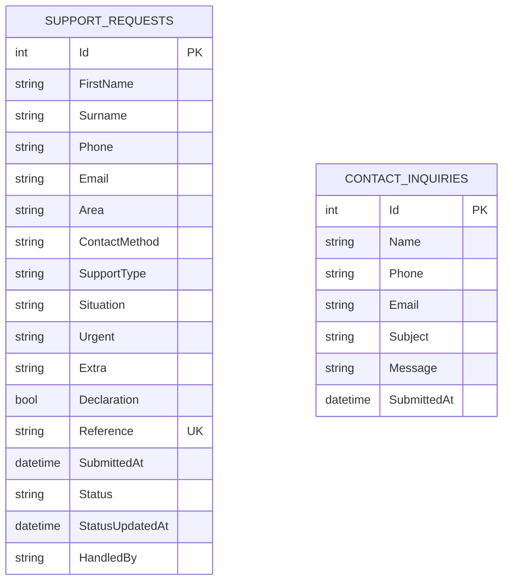

# Philisa Abantu Bethu – Help Centre

[](https://github.com/Kwethukubonga/PAB_WebApp/actions/workflows/dotnet-tests.yml)

**Web Application – Project README**

Developed by **Team KANTU** for **Philisa Abafazi Bethu**

---

## Table of Contents

1. [Overview](#1-overview)
2. [Functional Requirements](#2-functional-requirements)
3. [Non-Functional Requirements](#3-non-functional-requirements)
4. [Features](#4-features)
5. [Technology Stack](#5-technology-stack)
6. [System Architecture](#6-system-architecture)
7. [Languages and Localisation](#7-languages-and-localisation)
8. [Data Model](#8-data-model)
9. [Security and Privacy](#9-security-and-privacy)
10. [Getting Started](#10-getting-started)
11. [Project Structure](#11-project-structure)
12. [Deployment and Workflow](#12-deployment-and-workflow)
13. [Running Costs](#13-running-costs)
14. [Project Status and Future Work](#14-project-status-and-future-work)
15. [AI Usage Declaration](#15-ai-usage-declaration)
16. [Attendance](#16-attendance)
17. [The Team](#17-the-team)

---

## 1. Overview

The Philisa Abantu Bethu Help Centre is a public website where community members can ask Philisa Abafazi Bethu (PAB) for help, **without creating an account**. The name means *"Heal Our People"*.

- **Why it was built:** asking PAB for help currently means phoning them, so people need to already know the organisation. The Help Centre gives anyone a simple online way to reach PAB, and one place to find programmes and resources.
- **Who uses it:** community members only. There is deliberately no login, because an account would be a barrier for someone in a difficult or unsafe situation.

> For background on PAB and how the requirements were gathered, see the **Philisa Volunteers** README.

### 1.1 Links

- **Live site:** [*Philisa Abafazi Bethu Website*](https://philisa-abafazi-bethu-web.onrender.com/) (on free hosting, which sleeps after 15 minutes without visitors, so the first page after a quiet spell can take about a minute to appear)
- **Demo video:** [*Unlisted YouTube Link*](https://youtu.be/vqdMx4jWI7Y?si=peVstoh2Mlyq2UHJ)

---

## 2. Functional Requirements

Each requirement, the page it lives on, the code behind it, and the test that proves it still
works. Running `dotnet test` is therefore a check against this table, not just against the code.

| ID | Requirement | Where it lives | Code | Proven by |
|----|-------------|----------------|------|-----------|
| PAB-FR01 | Request support without creating an account or signing in. | `/RequestSupport` | No authorisation on the page or on `POST /api/support-requests` | `SiteIntegrationTests.RequestSupport_SavesAValidRequest…`, `ApiIntegrationTests.Posting_a_valid_request_returns_201…` |
| PAB-FR02 | Submit a support request through a simple, step-by-step form. | `/RequestSupport` | `wwwroot/js/request-support-wizard.js` | `RequestSupportModelTests`, `PublicPageTests.The_form_names_its_step_for_somebody_on_a_phone`, and the wizard walked step by step in the browser |
| PAB-FR03 | Choose a preferred contact method. | Step 1 | `SupportRequestValidator.ContactMethods` | `FormValidatorTests` (an unknown method is refused) |
| PAB-FR04 | Select or describe the type of support needed. | Step 2 | `SupportRequestValidator` + `SiteStrings.SupportTypes` | `FormValidatorTests` |
| PAB-FR05 | Give PAB the information it needs to respond. | Steps 1–2 | `SupportRequestValidator.Validate` | `FormValidatorTests`, `ApiIntegrationTests.Posting_an_empty_request_returns_400…` |
| PAB-FR06 | Receive confirmation once a request is submitted. | `/Confirmation` | `RequestSupportModel.OnPostAsync`, `ReferenceGenerator` | `RequestSupport_SavesAValidRequest_AndShowsItsReference`, `ReferenceGeneratorTests` |
| PAB-FR07 | Access helpful resources. | `/Resources`, `/offline` | `Data/ResourceData.cs` | `ApiIntegrationTests.Resources_lead_with_the_emergency_numbers` |
| PAB-FR08 | View information about PAB's programmes. | `/Programmes`, `/Programmes/{id}` | `Content/programmes.json`, `Data/ProgrammeContent.cs`, `Api/ContentEndpoints.cs` | `ProgrammeContentTests`, `ApiIntegrationTests.A_programme_comes_back_in_the_language_asked_for` |
| PAB-FR09 | Switch between English, isiXhosa and Afrikaans. | Every page | `Localization/`, `LangExtensions` | `PublicPageTests.A_page_comes_back_in_the_language_asked_for`, `…The_chosen_language_is_remembered_for_the_next_page`, `ApiIntegrationTests.A_programme_comes_back_in_the_language_asked_for` |
| PAB-FR10 | Submit a request from outside PAB's main service areas. | Step 1 | Area is free text with no area check | `FormValidatorTests` (any area passes) |

**Added during development:**

| ID | Requirement | Where it lives | Code | Proven by |
|----|-------------|----------------|------|-----------|
| PAB-FR11 | Send the PAB office a general message. | `/Contact` | `ContactValidator`, `ContactService` | `ContactModelTests`, `ApiIntegrationTests.A_valid_contact_message_returns_204…` |
| PAB-FR12 | PAB staff can see and act on requests. | `/Staff/Requests` | `Pages/Staff/`, `SupportRequestService` | `SiteIntegrationTests` staff cases, `ApiIntegrationTests` listing and status cases |
| PAB-FR13 | Leave the site at once if somebody walks in. | Every public page | `site.js` quick exit, Esc twice | `PublicPageTests.Every_public_page_has_the_quick_exit_button` (all nine pages) |
| PAB-FR14 | One API that both clients can use. | `/api/*` | `Api/` | The whole of `ApiIntegrationTests`. The Android app does not call it yet (planned: admins read web requests through it). |
| PAB-FR15 | The emergency numbers work with no data. | `/Resources`, `/offline` | `wwwroot/sw.js` | Checked by hand with the network switched off |

---

## 3. Non-Functional Requirements

| Category | How the Website Meets It |
|----------|--------------------------|
| **Accessibility** | Three languages, a "Skip to content" link, labelled form fields and icon buttons, and a page `lang` attribute that matches the chosen language so screen readers pronounce it correctly. |
| **Responsiveness** | Built mobile-first with Tailwind CSS, with a collapsible menu on small screens and cards and galleries that adapt to the screen width. |
| **Usability** | The support form is split into three short steps with a progress bar and a summary before submitting. **Request Support** is always in the header. |
| **Reliability** | Requests are saved before the confirmation page is shown, and Render only switches to a new deploy once `/health` answers. |
| **Security** | Every submission is checked on the server, the forms are rate-limited and have a spam trap, staff pages need a PAB admin sign-in, and every page sends strict security headers (see section 9). |
| **Safety** | A **Leave this site** button on every public page (or Esc twice) swaps the page for a weather search, for someone who needs to hide that they were looking for help. |

---

## 4. Features

### 4.1 Pages

| Page | What It Does |
|------|--------------|
| **Home** | Introduces PAB, with buttons to request support or explore programmes |
| **About Us** | PAB's story, mission, values, founder and team |
| **Our Programmes** | All ten programmes, each with its own page |
| **Programme detail** | Overview, objectives, activities, a photo gallery and testimonials |
| **Resources** | Emergency numbers and helpful contacts, plus FAQs |
| **Request Support** | The three-step support request form |
| **Confirmation** | Confirms the request and gives a reference number |
| **Contact** | A general contact form and PAB's contact details |
| **Privacy Policy** | How personal information is used, in line with POPIA |
| **Staff area** (`/Staff`) | For PAB staff only: new, in-progress and closed support requests, urgent ones first, and the full request with a way to move it along |

### 4.2 The Request Support Form

| Step | What the Person Fills In |
|------|--------------------------|
| **1. About You** | Name, phone number, email (optional), area, and preferred contact method: phone, WhatsApp, email or in-person visit |
| **2. Support Needed** | Type of support, a description of their situation, and whether it's urgent. A reminder to call **10111** or PAB's crisis line in an emergency. |
| **3. Confirm and Submit** | Anything else to add (optional), a summary of the request, and a consent declaration that must be ticked |

After submitting, the person sees a **reference number** (for example `PAB-7KQ39M`), the date, the status ("Received") and what happens next.

If something is missing or wrong, the form comes back with what they typed still filled in, a message next to each field that needs attention, and the step with the first problem open. The Submit button locks and shows "Sending…" so a request can't be sent twice.

**Types of support:** Food Assistance, Women's Empowerment, Youth Support, After-school Programme, Senior Care, Baby Saver Programme, Emergency Shelter, Search & Rescue, Social Work Services, and General Help / Not Sure.

### 4.3 Programmes and Resources

- **Programmes:** Women's Empowerment, Youth Programme, After-school Programmes, Senior Programme, Community Feeding, Baby Saver, Emergency Safe Houses, Search & Rescue, Social Work Services and Men's Café. Each page uses PAB's own photos, with a gallery that opens pictures full size.
- **Resources:** contacts grouped into Community Services, Emergency Contacts, Women's Rights, Parenting Resources and Mental Health, plus frequently asked questions such as *"Is my request kept private?"*

---

## 5. Technology Stack

| Area | Technology |
|------|------------|
| Framework | ASP.NET Core Razor Pages (.NET 10), C# |
| Database | SQLite, through Entity Framework Core 10 |
| Styling | Tailwind CSS, with Lora and Inter fonts |
| Client-side scripts | Plain JavaScript (form steps, mobile menu, FAQ, photo gallery, quick exit) |
| Staff sign-in | Firebase Authentication, the same accounts as the Philisa Volunteers app |
| Hosting | Docker, on Render |
| Testing and CI/CD | xUnit, ASP.NET Core integration tests, GitHub Actions |
| Version control | Git and GitHub |

**Why Razor Pages:** each page keeps its layout and logic together, which suits a content website with a few forms, and pages are rendered on the server, so they load quickly on slow connections.

**Why SQLite:** the whole database is one file, so there's no separate database server to run or pay for. Entity Framework creates and updates it automatically when the app starts.

> **Change from the design document:** the design planned Google Cloud Firestore for both systems. The website only needs to save two kinds of form submissions, so we moved it to SQLite, which is simpler and cheaper.

---

## 6. System Architecture

A fuller diagram, with trust boundaries and the request and staff sign-in flows, is in [docs/ARCHITECTURE.md](docs/ARCHITECTURE.md).

```
┌──────────────────────────────────────────────────────────────┐
│  BROWSER                                                     │
│  HTML pages · Tailwind CSS · form steps, menu, FAQ, gallery  │
└───────────────────────────┬──────────────────────────────────┘
                            │ HTTPS
┌───────────────────────────▼──────────────────────────────────┐
│  ASP.NET CORE (Razor Pages)                                  │
│  Pages/             Page + PageModel for each screen         │
│  Forms/             Server-side checks for both forms        │
│  Services/          Saving and reading requests              │
│  Staff/             Staff sign-in and admin check            │
│  Security/          Rate limiting and security headers       │
│  Localization/      English, isiXhosa and Afrikaans text     │
│  Data/SiteData      Programme content (stored in code)       │
│  Data/AppDbContext  Entity Framework database access         │
└──────────────┬────────────────────────────┬──────────────────┘
               │                            │ staff sign-in only
┌──────────────▼───────────────┐ ┌──────────▼───────────────────┐
│  SQLite DATABASE             │ │  FIREBASE (Google)           │
│  (philisa.db)                │ │  Authentication · Firestore  │
│  SupportRequests             │ │  users/{uid}.role == admin   │
│  ContactInquiries            │ │                              │
└──────────────────────────────┘ └──────────────────────────────┘
```

### 6.1 How a Support Request Is Handled

1. The browser checks the required fields before each step.
2. On submit, the form is posted to `RequestSupport.cshtml.cs`. More than 5 sends from one connection in 10 minutes gets a "please wait" page with the crisis line instead.
3. `Forms/SupportRequestForm.cs` checks every field again on the server, including South African phone numbers (the same rules as the Philisa Volunteers app). Anything wrong goes back to the form; nothing is saved.
4. `Services/SupportRequestService.cs` gives it a reference number such as `PAB-7KQ39M` and saves it to `SupportRequests` with the status **New**. A unique index makes a repeated reference impossible.
5. Once it's saved, `Services/StaffAlerts.cs` emails PAB's inbox: the reference, the kind of help (in English), whether it's urgent, when it arrived and a link to the request. Nothing personal goes in the email (see section 9). If the email fails, the request is still saved and the person still gets their reference.
6. The person is sent to the **Confirmation** page with their reference number.
7. PAB staff see it under **Staff → Support requests**, urgent requests first, and move it to **In progress** and then **Closed**.

The **Contact** form works the same way, saving to `ContactInquiries`. PAB gets an email with the message's subject and time, and staff read the message itself under **Staff → Messages**.

### 6.2 How Staff Sign In

Staff use the admin account they already have in the Philisa Volunteers app, so there's no second set of passwords.

1. On `/Staff/SignIn` the browser signs in to Firebase (email and password, or Google) and sends the ID token to the server.
2. The server checks the token's signature and that it was issued for the `pab-volunteers` project (`Staff/FirebaseTokenVerifier.cs`).
3. It reads that person's own `users` record from Firestore with their token, which the Firestore rules already allow, and only continues if `role` is `admin` (`Staff/StaffDirectory.cs`).
4. It starts its own 8-hour session cookie (HttpOnly, SameSite Strict). The Firebase sign-in isn't kept in the browser.

### 6.3 The API

The Razor pages used to write straight to `AppDbContext`, which meant the website and the Android
app had nothing in common underneath. Both now go through the same services, and those services
sit behind a REST API that either client can call. There is one path for validating and saving a
request, whether it arrives from the form or from the Android app.

Its description is published at **`/openapi/v1.json`**, and endpoint groups live in `Api/`, one
file per resource.

| Method and path | Who may call it | Gives back |
|---|---|---|
| `POST /api/support-requests` | Anyone | `201` with the reference, `400` with the fields that need attention, `429` when rate-limited |
| `GET /api/support-requests?status=&urgent=&page=&pageSize=` | PAB admins | `200` with a page of requests, without the situation text; `401` signed out, `403` not an admin |
| `GET /api/support-requests/{id}` | PAB admins | `200` with the request in full, `404` if there is no such request |
| `PATCH /api/support-requests/{id}` | PAB admins | `200` with the updated request, `400` for a status we don't use |
| `POST /api/contact` | Anyone | `204`, or `400` with the fields |
| `GET /api/programmes`, `GET /api/programmes/{id}` | Anyone | `200`, cacheable for an hour, in the language asked for |
| `GET /api/resources` | Anyone | `200`, emergency numbers first |
| `GET /health` | Anyone | `200` healthy, `503` when the database can't be reached |

**Signing in as a client.** The staff endpoints take the Firebase ID token the Android admin app
already holds, as `Authorization: Bearer <token>`. The token proves who somebody is; being a PAB
admin is checked separately against Firestore, so a volunteer's valid token gets `403`, not `200`.

**Errors.** Every API error comes back as RFC 9457 problem details, in one shape, with
`application/problem+json`. A validation failure names each field. Nothing internal is ever in
the message: anything unexpected becomes a plain `500` that still gives the crisis line.

---

## 7. Languages and Localisation

The website is available in **English**, **isiXhosa** and **Afrikaans**.

- The language switcher adds `?lang=en`, `?lang=xh` or `?lang=af` to the page address.
- The choice is saved in a `pab_lang` cookie for one year. The default is English.
- Every piece of text lives in `Resources/`, one file per language: `SharedResource.resx` (English), `SharedResource.xh.resx` (isiXhosa) and `SharedResource.af.resx` (Afrikaans). A translator can check one file instead of reading every page. Pages ask for text by name:

```csharp
@s["Layout.SkipContent"]                                      // "Skip to content"
@s.Format("SupportRequestForm.PleaseKeepUnderCharacters", 500) // "Please keep this under 500 characters."
```

- A test (`SharedResourceTests`) fails if any text is missing from the isiXhosa or Afrikaans file, so a page can't quietly fall back to English.

- The page's `lang` attribute is set to match (`en-ZA`, `xh-ZA` or `af-ZA`).

---

## 8. Data Model

### 8.1 Entity Relationship Diagram

The database has two independent tables, kept separate on purpose so general messages are never mixed with confidential support requests.



### 8.2 Field Notes

| Field | Values |
|-------|--------|
| `ContactMethod` | `phone`, `whatsapp`, `email` or `visit` |
| `Urgent` | `yes` or `no` |
| `Declaration` | Must be ticked before a request is submitted |
| `Reference` | `PAB-` and six characters, e.g. `PAB-7KQ39M`, leaving out look-alikes such as 0/O and 1/I. Unique: the database refuses a repeat. Older requests kept their `PAB` + three digit references. |
| `SubmittedAt`, `StatusUpdatedAt` | Stored in UTC and shown to staff in South African time |
| `Status` | `new`, `in-progress` or `closed`, changed by staff only |
| `HandledBy` | The staff member who last changed the status |
| `Subject` | General Enquiry, Volunteering, Donations & Partnerships, Media, or Other |

Indexes on `Reference` (unique), `Status` and `SubmittedAt` keep the staff lists quick.

**Programmes** are not stored in the database. They live in `Content/programmes.json`, with each programme's words in English, isiXhosa and Afrikaans side by side, because they rarely change and are the same for every visitor. The file is built into the app, and `ProgrammeContentTests` checks every programme has its English words, matching translations and pictures that exist.

---

## 9. Security and Privacy

Who could misuse the information on this site, what stops each of them, and the risks still open are set out in the [threat model](docs/THREAT_MODEL.md).

| Area | Measure |
|------|---------|
| No accounts for the public | No passwords to protect, and people only share what's needed to help them |
| Server-side checks | Every field is checked again on the server (`Forms/`): required fields, lengths, email and South African phone formats, and only the offered choices for contact method, support type and subject. Nothing is saved until it passes. |
| Rate limiting | Each connection may send the two forms 5 times in 10 minutes. After that it gets HTTP 429 and a page with the crisis line. Reading pages is never limited. |
| Spam trap | A hidden field that only bots fill in. When it's filled, nothing is saved. |
| Staff access | `/Staff` needs a Philisa Volunteers admin account (see 6.2). Staff pages are never cached (`Cache-Control: no-store`) or indexed by search engines, and status changes record who made them. |
| Security headers | Content Security Policy, `X-Frame-Options: DENY`, `X-Content-Type-Options: nosniff`, `Permissions-Policy`, and `Referrer-Policy: no-referrer`, so the address of a help page is never passed on to the next site someone visits |
| HTTPS | All traffic is redirected to HTTPS, with HSTS in production |
| Cross-site request forgery | Razor Pages add and check an anti-forgery token on every form |
| Cross-site scripting | Razor encodes anything a user types before displaying it |
| SQL injection | Entity Framework uses parameterised queries |
| Quick exit | **Leave this site** (or Esc twice) replaces the page with a weather search, and the Back button doesn't return to it |
| Logs | One line per request: method, path, status and time. The parts of a path that identify a request are reduced to a shape, so `/api/support-requests/41` is logged as `/api/support-requests/{id}`. No addresses, no query strings, nothing from a form. |
| Encryption at rest | The two columns that hold what somebody wrote about their situation are encrypted with ASP.NET Data Protection, so a copy of the database file or a backup can't be read. Everything else stays readable so staff can work. |
| Staff email alerts | The email about a new request carries only the reference, the kind of help, whether it's urgent and the time. Names, phone numbers, email addresses, the area and what the person wrote are never emailed, because inboxes get forwarded, synced to phones and read over shoulders. Staff sign in to see the rest. Contact message emails carry only the subject and the time; who sent it and what they wrote are on **Staff → Messages**. |
| Retention | Closed requests and contact messages are deleted after 12 months by a scheduled cleanup (`Services/RetentionService.cs`). A request nobody has closed is never deleted, however old. |
| Consent | A consent declaration must be ticked before submitting |
| Database file | `*.db` files are excluded from Git and the Docker image |
| Offline copy | The service worker keeps only the Resources page and the files it needs. Nothing anybody typed, no staff page and no API answer, because on a shared phone a saved page is one somebody else can open. The Resources FAQ has a button to clear it. |

The **Privacy Policy** page explains what is collected and why, that it's never sold or used for marketing, and people's POPIA rights to see, correct or delete their information.

---

## 10. Getting Started

**You need:** the .NET 10 SDK, Visual Studio 2022 or later (or the `dotnet` command line), and Git. Docker Desktop is optional.

**Step 1: Clone the repository**

```bash
git clone https://github.com/Kwethukubonga/PAB_WebApp.git
cd PAB_WebApp
```

**Step 2: Run it**

In Visual Studio, open `PhilisaAbantuBethu.slnx` and click **Run**. Or:

```bash
cd PhilisaAbantuBethu
dotnet run
```

**Step 3: Open the website**

Go to `http://localhost:5277`.

> **Note:** No database setup is needed. `philisa.db` is created automatically the first time the app starts. To view submissions during development, open it with a SQLite viewer such as **DB Browser for SQLite**.

**With Docker (Windows):** double-click `docker-setup.bat`. It makes a local development certificate, builds and starts the container, and opens `https://localhost:8443` (plain HTTP is on `http://localhost:8080`). After the first run, `docker compose up --build` is enough. Submissions are kept in the `philisa-data` volume. The container runs as a non-root user, and `TrustProxy` is off locally so the rate limiter uses the real connection address; it is only switched on behind the host's proxy (section 12.1).

**Staff sign-in:** register a **Web app** in the Firebase console for the `pab-volunteers` project (Project settings → Your apps → Add app → Web), then give the site its API key:
- **Locally:** put it in `"Firebase": { "ApiKey": "…" }` in `appsettings.Development.json`.
- **On Render:** set the variable `Firebase__ApiKey`.

Firebase web API keys aren't secret; every web page that uses Firebase sends one. For Google sign-in, also add the site's domain under Firebase → Authentication → Settings → Authorised domains.

**Email alerts (optional):** with no settings the site simply doesn't send them. Alerts go through [Resend](https://resend.com) (free for this volume), because free and cheap hosting plans block ordinary email (SMTP).

| Setting | Host variable | Example |
|---------|------------------|---------|
| Resend API key (**secret**) | `Alerts__ApiKey` | `re_…` |
| Sender, on a domain verified in Resend | `Alerts__From` | `PAB Help Centre <alerts@yourdomain.org>` |
| PAB's inbox (commas for more than one) | `Alerts__To` | `intake@yourdomain.org` |
| The live site, for the link in the email | `Alerts__SiteUrl` | `https://your-site.onrender.com` |
| Turn support request alerts off | `Alerts__SupportRequests` | `false` |
| Turn contact message alerts off | `Alerts__ContactMessages` | `false` |

The API key is a secret: never put it in `appsettings.json` or anywhere in Git. To try alerts on your own computer, keep it in user-secrets:

```bash
dotnet user-secrets set "Alerts:ApiKey" "re_your_key" --project PhilisaAbantuBethu
```

Until a domain is verified, Resend only lets `onboarding@resend.dev` send, and only to the email address the Resend account was made with.

**Run the tests:**

```bash
dotnet test PhilisaAbantuBethu.slnx
```

The integration tests start the real site against a throwaway database, with stand-ins for Google, so they run offline.

**Changing the design.** Colours, type, spacing and radii live in one file, `design/tokens.json`,
and are shared with the Android app. The stylesheet and the Tailwind theme are generated from it
and committed, so nothing here needs Node to run; you only need it to change the design.

```bash
npm install          # once
npm run build        # tokens -> tailwind.tokens.js, then the stylesheet
```

CI rebuilds them and fails if the committed copies don't match the tokens, so the two can't drift.

To write Android's `colors.xml` and dimens from the same tokens:

```bash
node tools/tokens/build.js --android ../PAB_Volunteers
```

**Adding a photo.** Put it in `wwwroot/img/`, then:

```bash
npm run images       # WebP copies at 400, 900 and 1600 wide, plus each photo's size
```

Pages use `<partial name="_Image" model='new SitePhoto(Src: "/img/…", Alt: "…")' />`, which serves
the WebP at the width the browser needs and keeps the original as the fallback.

**Database changes:** the EF Core tool is listed in `dotnet-tools.json`. Run `dotnet tool restore` once, then `dotnet ef migrations add <Name> --project PhilisaAbantuBethu`.

---

## 11. Project Structure

```
PAB_WebApp/
├── PhilisaAbantuBethu/
│   ├── Api/             # The REST endpoints, one file per resource, and the error format
│   ├── Data/            # AppDbContext, programme and resource content, the development seed
│   │   └── Protection/  # Encrypting the columns that describe what happened to somebody
│   ├── Forms/           # Server-side checks for the support and contact forms
│   ├── Localization/    # Language switching and text in all three languages
│   ├── Migrations/      # Database migrations for SQLite; Postgres/ holds the set for Postgres
│   ├── Models/          # SupportRequest, ContactInquiry, Programme
│   ├── Pages/           # Every page, the shared layout, and Staff/ for PAB staff
│   ├── Security/        # Rate limiting, security headers, request logging
│   ├── Services/        # Saving and reading requests, references, phone numbers, retention
│   ├── Staff/           # Firebase sign-in check, the admin role lookup, the bearer scheme
│   ├── wwwroot/         # The built stylesheet, the fonts, the scripts, PAB's photos, sw.js
│   └── Program.cs       # App start-up: services, security, API, language cookie
├── PhilisaAbantuBethu.Tests/   # Unit and integration tests
├── Styles/app.css       # The stylesheet's source; `npm run build` writes wwwroot/css/app.css
├── design/tokens.json   # The one place the colours, type, spacing and radii are written down
├── tools/tokens/        # Writes the Tailwind theme and Android's colors.xml from the tokens
├── tools/images/        # Writes the WebP copies and records every photo's size
├── tools/data-protection/  # Makes the certificate that locks the encryption keys
├── tools/database/      # Backs up the live database and proves a backup restores
├── .github/workflows/   # CI/CD: build, test, coverage, Docker build, deploy
├── .github/dependabot.yml
├── Dockerfile
├── docker-compose.yml
└── dotnet-tools.json    # The EF Core migrations tool
```

---

## 12. Deployment and Workflow

### 12.1 Deployment

The website is hosted on **Render** (free plan), built from the project's `Dockerfile`.

| Setting | Detail |
|---------|--------|
| Build | A two-stage image: the .NET 10 SDK publishes the app, then it runs on the smaller ASP.NET runtime |
| Port | Render supplies it through the `PORT` variable (the image falls back to `8080`) |
| Database | Postgres on Neon (free plan, Frankfurt), chosen by `ConnectionStrings__DefaultConnection`. Without that setting the site uses a SQLite file at `/data/philisa.db`, which is what runs locally. Render's free plan has no disk that survives a restart, so the hosted site can't use the file. The migrations run when the site starts, so a deploy that can't reach the database never goes live. |
| Encryption keys | In the database (the `DataProtectionKeys` table), locked with a certificate from the host's secret settings (`DataProtection__Certificate` and `DataProtection__CertificatePassword`). A restart loses nothing, and a copy of the database on its own can't be read. Without Postgres they are files at `/data/keys`. See section 12.4. |
| Health checks | `/alive` answers 200 while the site is running and never touches the database. It is Render's **Health Check Path** and what the uptime monitor asks. `/health` also checks the database, for looking by hand and after a deploy. Neon's free hours only last the month if the database can sleep between visitors, so nothing should ask `/health` every few minutes. |
| Visitors' addresses | `TrustProxy=true` and `TrustProxyHops=3`. Render lists the visitor third from the right in `X-Forwarded-For`, so that is the entry read. It keeps the form limit per visitor, and an address a visitor makes up lands further left, where it is ignored. If Render ever changes its proxies, test again from two devices on different networks. |
| Free plan | The service sleeps after 15 minutes without visitors, and the first request after that takes about a minute while it wakes. |
| Settings | `Firebase__ApiKey` for staff sign-in. `Alerts__ApiKey`, `Alerts__From`, `Alerts__To` and `Alerts__SiteUrl` for new-request emails (section 10). Optional: `RateLimiting__FormPostsPerWindow` and `RateLimiting__WindowMinutes`. |

### 12.2 CI/CD

`.github/workflows/dotnet-tests.yml` runs on every push and pull request:

| Job | What It Does |
|-----|--------------|
| **Build and test** | Restores, builds and runs every unit and integration test, keeps the results as a download, and builds the Docker image Render will use |
| **Deploy to Render** | Only on `main`, and only after the job above passes: asks Render to deploy that exact commit through its deploy hook, then checks the live `/health` |

To turn the deploy on, add one repository secret under **Settings → Secrets and variables → Actions**:
- `RENDER_DEPLOY_HOOK`: the service's deploy hook, from Render under **Settings → Deploy Hook**. Treat it like a password: anyone who has it can start a deploy.

If the live address ever changes, set a repository variable called `SITE_URL` to it. The Render service has no automatic deploys from GitHub, so every release goes through the tests first. Until the secret exists, the deploy job reports that it was skipped instead of failing.

### 12.3 Branching

```
 feature/* ─► Pull Request ─► Review ─► develop ─► Pull Request ─► main
```

`main` is the deployed version, and `develop` is where features are brought together.

### 12.4 Database, encryption keys and backups

Windows refuses to run `.ps1` scripts by default, so each of the three tools below is started as `powershell -ExecutionPolicy Bypass -File <script>`. That allows that one run only and changes nothing on the computer.

**Setting it up (once):**

1. **Neon:** create a project (the free plan needs no card) in AWS Europe Central 1 (Frankfurt), the same region as Render. From **Connect**, copy the **direct** connection string, not the pooled one.
2. **The certificate:** run `powershell -ExecutionPolicy Bypass -File .\tools\data-protection\New-KeyCertificate.ps1`. It writes the certificate and its password to a folder outside the repository. Put the `.pfx` and the password in the team's password manager straight away.
3. **Render, Environment:** add `ConnectionStrings__DefaultConnection` (the Neon string), `DataProtection__Certificate` and `DataProtection__CertificatePassword` (the text from the two files the script made), `TrustProxy` = `true`, `TrustProxyHops` = `3` and `Firebase__ApiKey`. In **Settings**, set the Health Check Path to `/alive`.

The site creates its tables the first time it starts. If the connection string or the certificate is missing or wrong, the new version refuses to start and Render keeps serving the old one.

**Why a certificate:** the keys that encrypt what people write about their situation have to live somewhere that survives a restart, and that is the database. Keys stored next to the text they open would protect nothing, so they are encrypted with the certificate, whose private half exists only in Render's settings and the password manager. Someone who copies the database but not the certificate gets text they can't open (this is tested).

> **If the certificate is lost,** the saved situation text can never be opened again. New requests keep working, because the site makes a fresh key. Names, phone numbers and emails are not encrypted, so they stay readable. Don't replace the certificate casually, and keep the backup copy safe.

**Backups:** run `powershell -ExecutionPolicy Bypass -File .\tools\database\Backup-Database.ps1`. It asks for the direct connection string without showing it, and writes a dated `.dump` file to `pab-backups` in your home folder. The file contains names and phone numbers, so keep it private and out of Git (Git is set to ignore it). Neon also keeps a short history on the free plan, which helps with a mistake made in the last few hours, but it is not a backup.

**Proving a restore:** run `powershell -ExecutionPolicy Bypass -File .\tools\database\Test-Restore.ps1`. It restores the newest backup into a temporary database on your computer, prints how many rows came back, then runs the site's own check, `dotnet run -- --check-decryption`, with the certificate to open every saved request. It prints counts only, never anybody's text, and removes the temporary database afterwards. It ends with **RESTORE TEST PASSED** or **RESTORE TEST FAILED**. Do this after the first backup, and again whenever the certificate or the database changes. It needs Docker Desktop and the .NET SDK.

---

## 13. Running Costs

| Item | Estimated Cost |
|------|----------------|
| Render hosting (free plan) | R0. The site sleeps when nobody has visited for 15 minutes. |
| Neon Postgres database (free plan) | R0 |
| SSL certificate | R0, included |
| `.co.za` domain (optional) | About R99 to register, then about R109 a year |

---

## 14. Project Status and Future Work

### 14.1 Current Status

| Area | Status |
|------|:------:|
| All pages, the support form and the contact form | ✔ Complete |
| English, isiXhosa and Afrikaans | ✔ Complete |
| PAB's real photos and programme galleries | ✔ Complete |
| Saving submissions, Docker and Render hosting | ✔ Complete |
| Server-side checks, rate limiting and spam trap on both forms | ✔ Complete |
| Unique reference numbers | ✔ Complete |
| Staff area to see and move requests along | ✔ Complete |
| Security headers, health check and quick exit | ✔ Complete |
| Automated tests (271) and CI/CD | ✔ Complete (deploy needs the Render deploy hook) |
| Shared REST API with OpenAPI, used by both clients | ✔ Complete |
| Service layer, so no page touches the DbContext | ✔ Complete |
| Constrained schema, staff notes and indexes | ✔ Complete |
| Situation text encrypted at rest, with a retention cleanup | ✔ Complete |
| One palette and type system shared with the Android app | ✔ Complete |
| Tailwind compiled at build time; fonts served from this site | ✔ Complete |
| Photos as WebP, lazy, at the width they are shown | ✔ Complete |
| Emergency numbers readable with no data | ✔ Complete |
| Managed Postgres database, keys in the database, backup and tested restore | ◑ Code, tests and tools ready; the live site switches over when Neon's connection string and the certificate are set on Render |
| Emailing PAB about new requests and contact messages, with no personal details | ✔ Complete (needs the `Alerts__` variables on the host) |
| Staff page for reading contact messages | ✔ Complete |

### 14.2 Future Improvements

- **Managed database, finishing touches:** the site uses Postgres wherever the connection string points at one, with its own migrations and its encryption keys in the database (section 12.4). What is left is scheduling the backups instead of running them by hand, and checking the database server's certificate: the connection to Neon is encrypted, but `Data/DatabaseProvider.cs` still sets `Trust Server Certificate=true`, so it does not yet prove it is talking to Neon itself.
- **Android reads the API:** PAB admins seeing web support requests inside the Philisa Volunteers app, through `GET /api/support-requests` with their existing admin token. The API side of this is finished and tested.
- **Lighthouse in CI:** a minimum score for performance and accessibility on every pull request.

---

## 15. AI Usage Declaration

### 15.1 Tools Used

- **Claude** (Anthropic), through Claude Code

### 15.2 Where AI Was Used

| Area | How |
|------|-----|
| Code | Bug Fixes |
| Translations | Xhosa and Afrikaans  |

### 15.3 How We Checked It

- **Purpose:** to speed up development, find and fix errors, and make sure the website met PAB's needs and the project requirements.
- **Checking:** the team set the requirements, reviewed every change through Pull Requests, and tested the website in the browser on phones and computers.

---

## 16. Attendance

All group members attended all group meetings, which took place every Monday.

| Meeting | Kwethukubonga Kunene | Letlhogonolo Kgatshe | Nuha Grimwood | Unathi Mudzengi | Ash Kruger |
|---------|:---:|:---:|:---:|:---:|:---:|
| 17 August 2026 | ✔ | ✔ | ✔ | ✔ | ✔ |
| 24 August 2026 | ✔ | ✔ | ✔ | ✔ | ✔ |
| 31 August 2026 | ✔ | ✔ | ✔ | ✔ | ✔ |
| 7 September 2026 | ✔ | ✔ | ✔ | ✔ | ✔ |
| 14 September 2026 | ✔ | ✔ | ✔ | ✔ | ✔ |
| 21 September 2026 | ✔ | ✔ | ✔ | ✔ | ✔ |
| 28 September 2026 | ✔ | ✔ | ✔ | ✔ | ✔ |

---

## 17. The Team

**Team KANTU:** Kwethukubonga Kunene · Letlhogonolo Kgatshe · Nuha Grimwood · Unathi Mudzengi · Ash Kruger

*Built for Philisa Abafazi Bethu – "Heal Our Women"*
