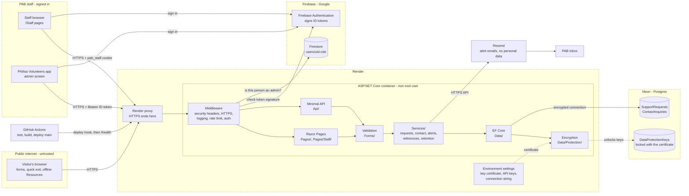
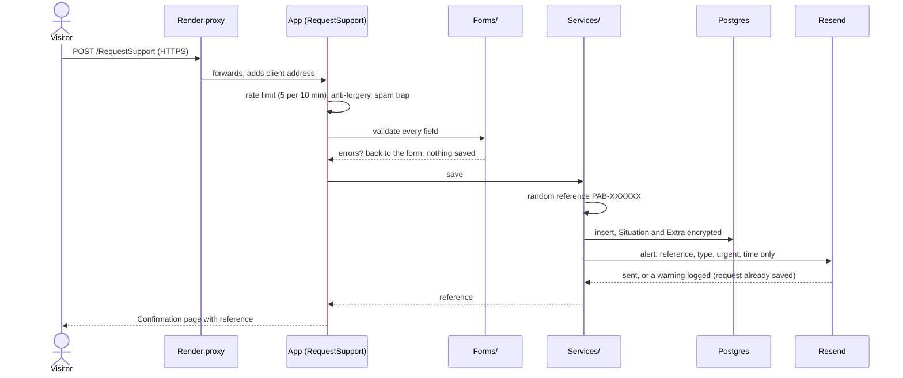
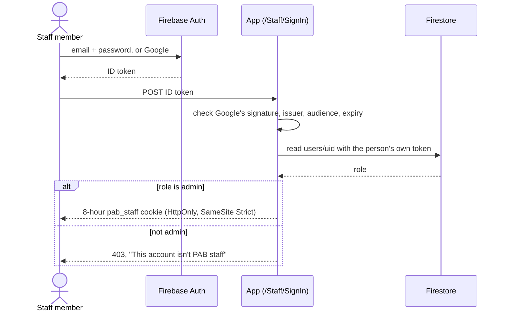

# Architecture – PAB Help Centre (web)

The Help Centre is one ASP.NET Core app (.NET 10, Razor Pages + minimal API) running in a Docker container on Render. It saves support requests and contact messages to a Postgres database on Neon, emails PAB through Resend when something new comes in, and uses Firebase only to check who PAB staff are, so staff sign in with the same admin account they use in the Philisa Volunteers app.

This page covers the web side. The Android side (Firebase, Firestore rules, notifications) is documented in the Philisa Volunteers repository. Who could misuse the data and what stops them is in [THREAT_MODEL.md](THREAT_MODEL.md).

---

## 1. System Diagram

The dashed boxes are trust boundaries: data crossing one of them is checked before it is trusted.

Locally the same app runs on a SQLite file with its keys in a folder, so nobody needs Neon or the certificate to work on it.

---

## 2. What Each Part Does

| Part | Where | Job |
|------|-------|-----|
| Middleware | `Program.cs`, `Security/` | Runs on every request, in this order: forwarded headers (behind Render only), error pages, security headers, HTTPS redirect, request logging, rate limiting, sign-in, permission checks, language cookie |
| Razor Pages | `Pages/` | The public pages and the two forms. `Pages/Staff/` is the staff area: support requests and contact messages. |
| Minimal API | `Api/` | The same features as JSON for the Android app: send a request or message, read programmes and resources, and (staff only) list, read and update requests |
| Validation | `Forms/` | Checks every field on the server. Shared by the pages and the API, so both follow the same rules. |
| Services | `Services/` | Saving and reading requests, reference numbers, the 12-month cleanup, and the alert emails (`StaffAlerts.cs`, `EmailSender.cs`) |
| Encryption | `Data/Protection/` | Encrypts `Situation` and `Extra` on the way into the database, and keeps the keys in the database locked with a certificate (`DataProtectionSetup.cs`) |
| Database access | `Data/` | Entity Framework Core. Postgres when the connection string points at one, SQLite otherwise (`Data/DatabaseProvider.cs`). Migrations run when the site starts. |
| Staff sign-in | `Staff/` | Checks Firebase ID tokens and the `admin` role in Firestore |
| Render | (host) | Builds the Docker image, ends HTTPS, holds the secret settings, and only switches to a new version once `/alive` answers |
| Neon | (host) | Managed Postgres in Frankfurt, the same region as Render |
| Firebase | (Google) | Signs staff in and holds the `role` on each user. The site keeps no list of staff of its own. |
| Resend | (email) | Sends the short "something new came in" emails to PAB's inbox over HTTPS |
| GitHub Actions | `.github/workflows/` | Runs the tests and Docker build on every PR; on `main`, triggers Render's deploy hook and checks the live `/health` |

---

## 3. Key Flows

### 3.1 Someone asks for support

### 3.2 A staff member signs in

The Android admin screen skips the cookie: it sends its Firebase ID token as `Authorization: Bearer` on each API call, and the same two checks run every time.

---

## 4. Android Side

*To be added by the Android team: Firebase Authentication, Firestore and its security rules, the notifications worker, and how the admin screen calls this site's API.*
